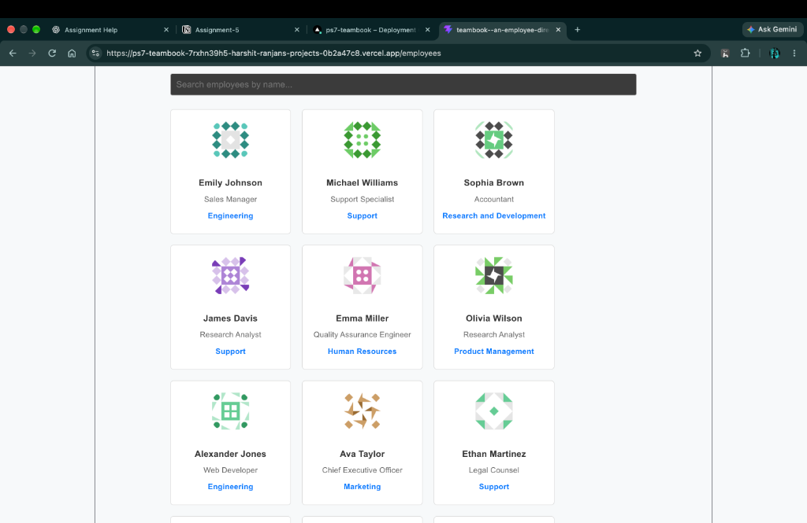
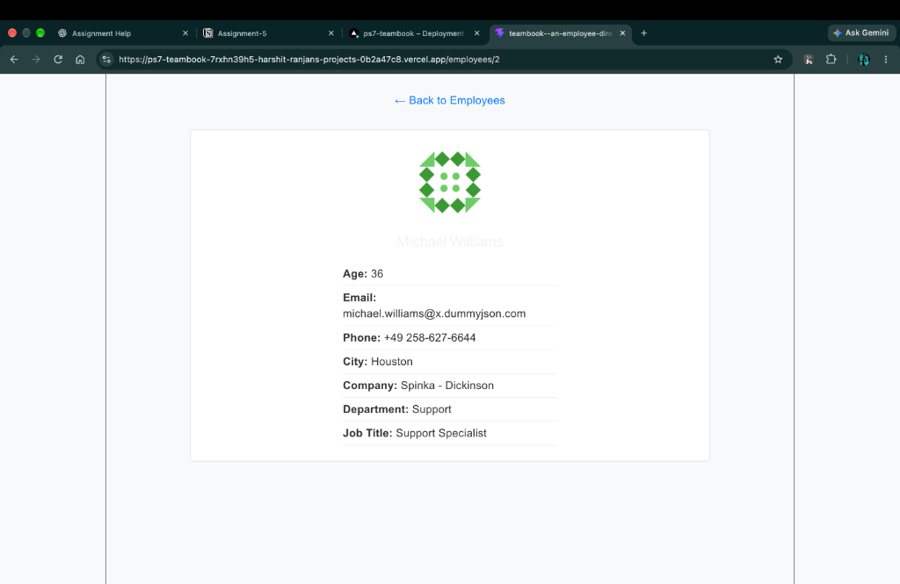

# PS7: TeamBook — Employee Directory

## Project Description
TeamBook is an internal employee directory application built with React, Vite, and React Router. It allows users to browse employee profiles fetched from DummyJSON API, search employees in real-time by name, and inspect individual employee details through dynamic routing.

## Technology Stack
- **Framework / Tooling:** React 19, Vite
- **Routing:** React Router v7 (`react-router-dom`)
- **API:** DummyJSON API (`fetch`)
- **Styling:** Vanilla CSS

## API Endpoints Used
- Employee Directory: `https://dummyjson.com/users?limit=30`
- Single Employee Details: `https://dummyjson.com/users/:id`

## Routes
1. `/` (Home)
   - Displays the TeamBook heading and a brief welcome message.
   - Provides a "View Team" button leading to `/employees`.
2. `/employees` (Directory)
   - Fetches and displays 30 employees from `https://dummyjson.com/users?limit=30`.
   - Shows employee photo, full name, job title, and department.
   - Includes real-time search input filtering employees by name.
   - Each card links to `/employees/:id`.
3. `/employees/:id` (Employee Details)
   - Reads the dynamic employee ID via `useParams()`.
   - Fetches individual employee data from `https://dummyjson.com/users/:id`.
   - Displays photo, full name, age, email, phone, city, company name, department, and job title.
   - Strictly protects privacy: password, SSN, and bank information are never displayed.
4. `*` (Not Found)
   - Catches all invalid or unknown routes.
   - Displays "Page not found" with a direct link back to Home.

## Screenshots
- **Employee Directory & Search:**
  

- **Employee Details Page:**
  

## Links
- **GitHub Repository:** [https://github.com/Harshitranjan07/ps7-teambook](https://github.com/Harshitranjan07/ps7-teambook)
- **Live Deployment:** [https://ps7-teambook.vercel.app](https://ps7-teambook.vercel.app)

## Local Setup & Running Instructions
1. Clone the repository:
   ```bash
   git clone https://github.com/Harshitranjan07/ps7-teambook.git
   cd ps7-teambook
   ```
2. Install dependencies:
   ```bash
   npm install
   ```
3. Run the development server:
   ```bash
   npm run dev
   ```
4. Open your browser and navigate to:
   ```
   http://localhost:5173
   ```
5. Build for production:
   ```bash
   npm run build
   ```
